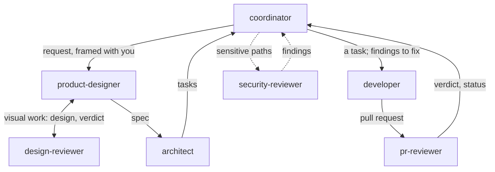

# ola-workflow

A team of Claude Code agents — a coordinator, a product designer and an independent design
reviewer, an architect, developers working in isolated worktrees, an independent PR
reviewer and, on the paths a project declares, a security reviewer — whose two irreversible
acts, merging and setting the review status, GitHub itself keeps with the role that owns them.

The workflow is **generic**: everything project-specific lives in a profile file, so the
same plugin drives a project you own and a repository you contribute to twice a year
**without committing anything to it**.

## How it works

You talk to one agent, the **coordinator**. It hands the work from role to role, in the steps
below. Each reads **role** — what it does — what it produces. A change that no user sees and that
fits one pull request skips steps 2 to 4.

1. **coordinator** — asks you only if your goal is unclear — a request in one sentence.
2. **product-designer** — says what "done" means, and the words users read — a spec.
3. **design-reviewer** — checks the design, for visual work only — a verdict. You settle a dispute.
4. **architect** — splits the spec into small tasks — one issue per task.
5. **developer** — builds one task, test first, in its own worktree — a pull request.
6. **pr-reviewer** — reviews what it did not write — a verdict and an `agent-review` status.
7. **security-reviewer** — also reads changes to paths the project lists as sensitive — findings, each blocking one read again.
8. **coordinator** — merges once the checks, the review status and any security review are green.
   You merge instead when a change touches a sensitive path; in a repository that is not yours, nobody does.



The agents decide the rest alone, taking the option closest to existing code. Yours to decide:

- Scope and product: what a user sees, departing from what was asked.
- Dependencies: a new runtime dependency, any major version upgrade.
- Process and security: CI, rulesets, quality thresholds, hooks, agent definitions.
- Release: whether to release, and the version. The release is your act.

Each role writes down what the next needs: on GitHub (issues, labels, the `agent-review` status) in
your own project, in local files in a repository that is not yours. A project opts in with a profile
file; without one, nothing happens. See [Configuration](docs/configuration.md).

Each role works with its own GitHub token. GitHub refuses two acts to the others: merging, kept by
the coordinator, and setting the review status, kept by the pr-reviewer. Pushing to the base
branch, tags and releases rest on the agents' rules alone: see [GitHub tokens](docs/github-tokens.md#what-it-does-not-stop).

A whole request, step by step, is in the [walkthrough](docs/walkthrough.md).

## Install

```
/plugin install ola-workflow --marketplace olaurendeau/ola-workflow
```

or, from a shell:

```bash
claude plugin install ola-workflow --marketplace olaurendeau/ola-workflow
```

User scope is the default, which is what you want: install once, use everywhere. Then, in a
terminal, create the tokens the agents work with — see [GitHub tokens](docs/github-tokens.md):

```bash
ola-workflow-tokens setup
```

## Status

**The team is complete, and GitHub refuses two things a role does not own.** Two, not all:
merging belongs to the coordinator and the review status to the pr-reviewer, and every agent
works with a token that can do neither. Pushing to the base branch, tagging, releasing,
publishing and changing repository settings are **not refused by anything** — they are rules
the prompts carry and nothing applies, which is a different thing from a rule. See
[What it does not stop](docs/github-tokens.md#what-it-does-not-stop).

In place: the manifests, the CI,
the test harness, the answer to how a plugin agent is identified (see
[Agent identity](docs/agent-identity.md)), the project profile with its schema and its
`ola-profile` CLI, the **seven roles** (`agents/` also ships `probe`, a measuring tool that
is no part of the flow) — a coordinator that frames and dispatches, a product
designer that turns a request into criteria a test can prove and the words a user reads, and
for visual work publishes the design as a claude.ai artifact it keeps at one URL, a design
reviewer that judges that page against the epic, an architect that splits an
epic into reviewable tasks, developers that build test-first in their own worktrees, an
independent reviewer, and a security reviewer dispatched beside it when a change touches the
paths the project declares, whose blocking findings each go to a second, cold reading before
a developer sees them — and the **role tokens**.

A project with no profile is unaffected, which is the whole point of the design: both hooks
exit before doing anything, and its sessions keep your own GitHub login.

### What is not here yet

| step | content |
|---|---|
| A3 | pushing to the base branch, tags, releases, repository settings |
| A4 | declarative `commands[]` rules, discreet mode's prohibitions on the forge and on pushing (a merge and a review status are refused there too, by the tokens), the conditional merge gate |
| A6 | the `verify-ui` skill, then 1.0.0 |

Until the merge gate exists, the coordinator checks it by hand against the forge: GitHub
checks *who* merges, not whether the checks were green.

### Globs

Every glob in a profile is a git pathspec `:(glob)`, and `schema/profile.schema.json` states
the rule for whoever writes one. Two notes for whoever *implements* a key that consumes
them:

- **Let git do the matching** — `git diff --numstat base..head -- . ':(glob,exclude)<pattern>'`
  does it inside the command that already counts lines. Re-implementing the dialect with a
  shell `case` would silently widen `pr.exclude` and `sensitive_patterns[].exclude`, and
  widening those two *removes* coverage, which is the one direction that matters.
- **The recursion keys on literal versus glob**, not on the absence of a slash: `docs` and
  `src/deep` pull in their subtrees, while `doc*`, `doc?` and `[dx]ocs` match nothing at
  all. That is what makes the schema's own example sound — `Dockerfile*` cannot reach into a
  neighbouring `Dockerfiles/`.
